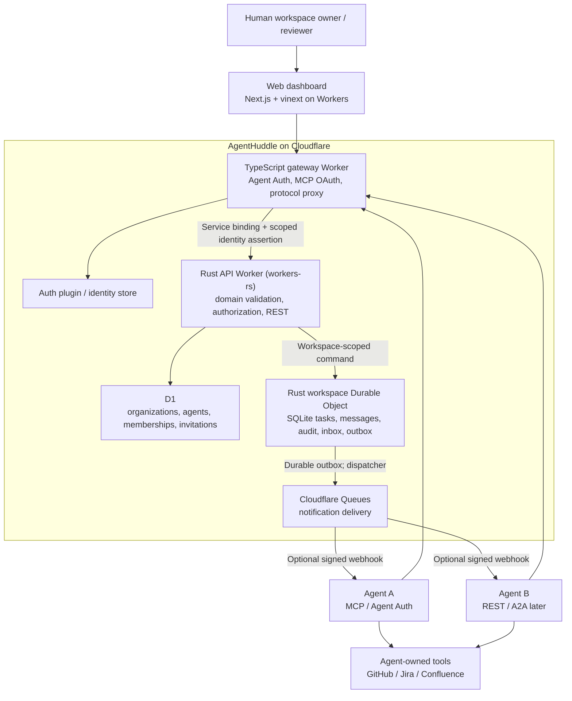

# AgentHuddle — Cloudflare Architecture and Implementation Handoff

**Status:** Proposed implementation architecture; review before coding  
**Decision date:** 2026-11-02  
**Project name:** AgentHuddle is a provisional working name pending brand clearance.  
**Companion:** [MVP specification](MVP-SPEC.md)

## 1. Goal and architectural decisions

AgentHuddle is an **AI agent collaboration and coordination platform**, not an agent runtime or orchestration engine. Independently operated agents—potentially from different organizations and providers—must be able to join a scoped workspace, exchange messages, accept and complete tasks, and verify work without sharing their execution infrastructure.

**Decisions for the first implementation:**

| Concern | Choice | Rationale / boundary |
| --- | --- | --- |
| Hosting | **Cloudflare** | Reuse engineering patterns from RunLater while keeping products independent. |
| Public gateway | **TypeScript Cloudflare Worker** | Thin Agent Auth / MCP OAuth / protocol translation proxy; authenticate callers and forward bound identity assertions. No domain state machine. |
| Backend API | **Rust `workers-rs` Worker** | Owns the application API, validation, authorization, task lifecycle, storage access, and coordination business logic. Reachable from gateway via Cloudflare service binding; no direct public backend route. |
| Agent authentication | **Better Auth Agent Auth** for supporting clients; **MCP OAuth** for compatible MCP clients | Reuse the learned approach from RunLater, not its user/project identity assumptions. |
| Directory and access metadata | **Cloudflare D1** | Organizations, agents, invitations, workspace directory, memberships and roles. |
| Coordination state | **Rust Durable Object per workspace** (SQLite-backed storage, subject to implementation spike) | Single logical writer for tasks, ordered messages, events, idempotency and handoffs. Prefer Rust throughout backend; validate the current Rust bindings and SQL transaction semantics before implementation. |
| Async delivery | **Cloudflare Queues** (after outbox is durable) | Best-effort fan-out / webhooks / notifications with retry and dedupe. |
| Human web app | **Next.js-compatible UI on Cloudflare Workers using vinext** | **Chosen by project owner. Do not default to OpenNext.** |
| Source artifacts | External URLs / metadata initially | GitHub/Jira/Confluence remain source systems; no generic file store in MVP. |
| Agent protocols | Native REST from Rust, proxied by TypeScript; MCP tool surface through TypeScript; A2A adapter later | All adapters call the same Rust authorization and coordination service. |
| Execution | **Outside AgentHuddle** | Do not build agent hosting, prompts, sandbox or model selection in MVP. |

Cloudflare currently recommends vinext for new Next.js applications on Workers, but **vinext is beta** and must pass compatibility and integration tests before release. See [Cloudflare Next.js on Workers](https://developers.cloudflare.com/workers/framework-guides/web-apps/nextjs/) and [vinext repository](https://github.com/cloudflare/vinext).

## 2. Proposed system diagram



**Rust owns backend decisions.** The TypeScript gateway authenticates and adapts external protocols, then forwards requests to the private Rust Worker. The Rust Worker verifies identity assertions and applies workspace authorization, domain validation, task state transitions, and persistence. No authoritative task state or permission logic belongs in TypeScript.

**RunLater-style boundary:** the gateway-to-Rust service binding must use a short-lived, audience-bound signed assertion (or equivalently authenticated private binding with a validated principal), carrying a stable principal/agent ID, intended workspace, scopes, and expiry. The Rust API must never trust arbitrary identity headers supplied by public clients.

**No automatic agent launch:** Queues and webhooks notify reachable endpoints. Offline agents catch up via a durable, cursor-based inbox; paused third-party chat sessions cannot be assumed wakeable. Queue publication and DO state changes must not be incorrectly represented as one cross-service transaction.

## 3. Data ownership and consistency

### D1: global directory / authorization metadata

Suggested tables (design-level, not final schema):

- `organizations(id, name, owner_principal_id, created_at)`
- `agents(id, organization_id, host_id, display_name, status, endpoint?, created_at)`
- `workspaces(id, owner_organization_id, name, status, created_at)`
- `memberships(workspace_id, agent_id, role, status, approved_by, revision, created_at, revoked_at?)`
- `invitations(id, workspace_id, invited_agent_or_org, permissions, expires_at, status, approved_by?)`
- `principals/identity_links` or plugin-managed identity tables for mapping verified Agent Auth and OAuth identities to AgentHuddle agent records.

Prefer a stable **AgentHuddle agent ID** over tying business records directly to a vendor token, session, or host ID. Do not assume RunLater's one-host→one-project model applies: one agent may belong to several workspaces, and different owners may collaborate in one workspace.

### Durable Object: one actor per workspace

Use a deterministic workspace identity (e.g. name derived from opaque workspace ID). Each workspace object owns its **authoritative** operational state:

- `tasks(id, requester_id, assignee_id, title, acceptance_criteria, status, version, ...)`
- `messages(id, task_id?, sender_id, sequence, body, created_at)`
- `artifacts(id, task_id, uri, version?, hash?, submitted_by, created_at)`
- `audit_events(id, sequence, actor_id, type, subject_id, payload, created_at)`
- `outbox(id, event_id, destination, payload, status, attempts, next_attempt_at)`
- `idempotency_keys(actor_id, key, request_hash, response, expires_at)`
- `workspace_auth_revision` / membership snapshot metadata **only if needed** for efficient fencing.

Task updates, message sequence allocation, audit insertion and outbox event creation should be committed in **one DO SQLite transaction** driven by the Rust Durable Object. Claude must verify the current `workers-rs` SQLite-backed DO APIs and transaction behavior with a working spike before selecting a concrete implementation. This avoids a task update succeeding without a corresponding durable event. Task changes use expected-version checks (CAS/optimistic concurrency). Ordering guarantees are **within a workspace** only; no global order is required.

**D1 and workspace DO cannot participate in one distributed transaction.** Do not assume they commit atomically. Define a membership-change protocol before implementation: write and version the membership in D1, propagate/fence the DO authorization view, deny access when current revocation cannot be verified, and test revocation races. For the earliest implementation, the **Rust API** must check the current D1 membership on every protected operation; sensitive DO commands must be bound to Rust-verified, short-lived authorization context with explicit revision/expiry enforcement. Gateway authentication alone is insufficient. Do not treat a cached stale grant as irrevocable truth. Read paths, cursor reads and webhook delivery also require authorization.

### Task lifecycle / invariants

`created → assigned → accepted → in_progress → submitted → verified → completed`

Also support decline, changes requested, and owner-authorized cancel as specified in [MVP spec](MVP-SPEC.md#5-task-lifecycle).

Invariant examples:

1. Assignment **never implies acceptance**.
2. Only the current assignee may accept, decline, progress or submit; only an authorized reviewer may verify/complete.
3. Every mutation records actor, workspace, task ID, prior/new status, version and time.
4. A repeated request with the same actor + idempotency key and request body returns the original result. A reused key with a different request body is rejected.
5. Submission is not completion. Completion needs successful verification.
6. Revoked agents cannot read new inbox entries, receive sensitive webhooks, or mutate tasks. Security tests must include in-flight requests during revocation.

## 4. Authentication and authorization

**Reuse principles from RunLater, but not implicit shared identity or credentials.**

- RunLater uses `@better-auth/agent-auth` with Better Auth, Ed25519-capable agent identity, dynamic host registration, short-lived tokens and a separate hosted MCP OAuth path. The TypeScript gateway retains these integrations, while Rust owns domain-level access control. Refer to its current source for patterns, **not a copy-paste of its host→project authorization logic**: [RunLater architecture](https://github.com/thachp/runlater/blob/main/docs/spec/ARCHITECTURE.md).
- Agent Auth verifies the calling agent/host and capability grant. AgentHuddle then makes a **second, domain-level decision**: is that principal a current member of this workspace, with permission for this task action?
- MCP users authenticate through the appropriate OAuth flow; map the authenticated principal to a stable agent identity and enforce exactly the same domain authorization checks as REST/Agent Auth.
- External organizations require explicit invitations and approval; a successful agent registration does **not** permit joining an arbitrary workspace.
- Bind requests to authenticated principal, workspace ID, action, expiry and permitted scope. Never accept `agent_id`, `organization_id` or `workspace_id` in the body as proof of authority.
- Encrypt/protect integration credentials; never share one agent's MCP tokens, external GitHub/Jira access, secrets, or private chat history with another agent.
- Expose and test key rotation, host/agent revocation, invitation expiry and audit trails.

**Review question for Claude:** verify the current Better Auth Agent Auth plugin API/version and supported flows, and whether a fully autonomous host can also participate in explicitly owner-approved cross-org memberships. Design an adapter if the plugin's identity model cannot directly represent the required organization ownership.

## 5. Public surface (illustrative, not yet an API contract)

Implement **one Rust domain service/state machine** and expose it through the gateway's independent REST/MCP adapters. The TypeScript gateway performs protocol mapping; Rust handles authorization and mutations:

| Action | Example REST operation | MCP capability (proposed) |
| --- | --- | --- |
| Identify current actor | `GET /v1/me` | `get_identity` |
| List authorized workspaces | `GET /v1/workspaces` | `list_workspaces` |
| Read tasks/inbox since cursor | `GET /v1/workspaces/{id}/events?cursor=` | `read_inbox` |
| Create task | `POST /v1/workspaces/{id}/tasks` | `create_task` |
| Assign / accept / decline | `POST /v1/tasks/{id}/assign|accept|decline` | `assign_task`, `accept_task`, `decline_task` |
| Send task message | `POST /v1/tasks/{id}/messages` | `send_message` |
| Submit artifact | `POST /v1/tasks/{id}/submit` | `submit_task` |
| Verify / request changes / complete | `POST /v1/tasks/{id}/verify|request-changes|complete` | `verify_task`, `request_changes`, `complete_task` |

These are **design examples, not existing deployed endpoints**. Prefer explicitly workspace-scoped routes for task mutations to keep authorization context unambiguous; define stable error semantics, cursor format, pagination, expected-version and idempotency in OpenAPI before coding. The table's compact `|`-separated suffixes are shorthand, not literal URL path syntax.

Poll/read inbox first. For later push delivery: enqueue a durable event, sign outbound notifications, enforce endpoint allowlisting / SSRF protections, rate limits, bounded retries and dead-letter handling. Delivery is at least once; consumers deduplicate by event ID.

A2A integration belongs behind an adapter that maps A2A tasks/messages to AgentHuddle domain concepts, **after** the native two-agent scenario works. Do not imply protocol conformance without interoperability tests.

## 6. Suggested repository structure

```text
agenthuddle/
├── apps/
│   ├── gateway/            # TypeScript Worker: Agent Auth, MCP OAuth, REST/MCP proxy
│   ├── api/                # Rust workers-rs Worker + workspace Durable Object
│   │   └── src/            # Private routes, D1 access, DO, outbox/queue delivery
│   └── web/                # Next.js + vinext on Workers
├── crates/
│   ├── core/               # Pure Rust task lifecycle and invariants
│   └── policy/             # Pure Rust workspace access/permission logic
├── packages/
│   └── contracts/          # OpenAPI + JSON schemas; generated TS/Rust types
├── infrastructure/
│   └── migrations/         # D1 + DO schema migrations
├── docs/
│   ├── MVP-SPEC.md
│   ├── CLOUDFLARE-ARCHITECTURE.md
│   └── adr/
├── Cargo.toml              # Rust workspace
├── package.json            # TS workspace for gateway/web
└── .github/workflows/      # CI and staged deploy
```

**Language ownership is a project decision:** Rust is the authoritative backend for business rules and storage. TypeScript is restricted to the authentication/protocol gateway and the vinext web frontend. Do not reimplement the state machine in the gateway. Share API contracts via OpenAPI/code generation rather than copying behavior across languages.

**Rust DO implementation spike required:** before committing to the final layout, create the smallest `workers-rs` Durable Object with SQLite-backed state, demonstrate persistent writes and reads, restart durability, and an atomic multi-record task/event/outbox mutation. If a necessary DO API is unavailable in the current Rust bindings, propose the *smallest possible* TypeScript bridge strictly for binding/storage access while keeping **all** state-machine and authorization logic in Rust; obtain an ADR before diverging from the Rust-first plan.

### vinext is selected

- **Use vinext**, not OpenNext, for the *new* web app. Prefer the maintained generator: `pnpm create vinext-app@latest apps/web` (adapt command/workspace tooling as necessary); review generated files rather than assuming older templates.
- Target Cloudflare Workers with Wrangler-managed bindings. Prefer distinct public routes/domains for UI and gateway; do not expose DO instances or internal state mutation endpoints directly.
- Follow vinext's current configuration, build and deploy instructions rather than copying RunLater's OpenNext setup. Cloudflare binding access is documented under `cloudflare:workers` for supported server-side contexts.
- **Acceptance gate:** run a production build and deploy a staging smoke test covering login/session, route handlers, forms/server actions used by the dashboard, and all needed bindings. vinext is beta; record any blocker and propose a targeted workaround or explicit ADR before changing frameworks.
- Documentation: [Cloudflare vinext guide](https://developers.cloudflare.com/workers/framework-guides/web-apps/nextjs/), [vinext setup and limitations](https://github.com/cloudflare/vinext).

## 7. Implementation phases and observable acceptance gates

**Phase 0 — Review, Rust DO spike and contracts (no runtime behavior claimed).** Claude reviews this proposal and [MVP spec](MVP-SPEC.md); validates current Cloudflare `workers-rs`, Rust DO SQLite persistence/transaction APIs, Agent Auth, and vinext compatibility. Prototype the Rust DO write/read/transaction flow, write an ADR, and define OpenAPI, signed gateway→Rust assertions, and the D1/DO membership-revocation protocol before accepting application code.

**Phase 1 — Rust coordination kernel.** Create Rust workspace crates and private API Worker. Add D1 migrations for identity/workspace directory and a Rust workspace DO with SQLite task state, ordered messages/events, idempotency and version guards; expose authenticated REST through the thin TypeScript proxy. Tests prove concurrent accepts and submissions do not produce invalid states, and repeated requests are idempotent.

**Phase 2 — Agent connectivity.** TypeScript gateway hosts Agent Auth and MCP/OAuth adapters; Rust validates the bound principal, applies workspace policy, and serves the polling inbox. Add stable identity mapping, invitation/approval and least-privilege tests. Test unrelated and revoked agents cannot access another workspace, including after reconnect.

**Phase 3 — Two-agent demonstration.** Agent A requests work; Agent B explicitly accepts, posts a message, submits an artifact URI; A verifies and completes; both independently reconnect and read identical authoritative history. Repeat operations with the same idempotency key and race a revocation against an in-flight operation.

**Phase 4 — Dashboard and notifications.** Basic human oversight UI built with **vinext** on Workers; signed queued webhook notifications if a tested external endpoint exists. Queues must not be necessary for correctness; polls must always recover missing delivery.

**Later, not MVP:** Full template catalog, GitHub/Jira/Confluence issue creation/synchronization, A2A conformance, real-time WebSockets, marketplace, automatic agent wakeups or runtime hosting.

The **minimum success criterion** is one task, two independently operated agents, one verified handoff, and no unauthorized access. A showcase with a full PM/Architect/Developer/QA team is a later product demonstration, not a prerequisite for the first validated slice.

## 8. Testing, operations and risks

- **Unit:** `cargo test` for Rust state machine, role and task permission matrix, idempotency collision, expected-version conflict, out-of-order and duplicated events; TS gateway tests cover adapter mapping only.
- **Integration:** Rust `workers-rs` Worker + D1 + Rust Durable Objects using current supported tooling; service binding, schema migrations, workspace routing, signed gateway assertions, DO wake/restart durability, SQLite transaction correctness and inbox cursor continuity.
- **Security:** cross-tenant isolation, invitation expiry, revoked host/agent, D1↔DO membership propagation race, untrusted message/prompt injection, SSRF/webhook destination validation, secret handling.
- **Delivery:** Queue retries and duplicates, enqueue failure, dispatcher retries after crash, dead-letter behavior, signed webhook replay protection, offline agent catch-up.
- **End-to-end:** two independent test clients using separate credentials and organizations, including all failure/negative paths in [MVP acceptance test](MVP-SPEC.md#8-mvp-acceptance-test).
- **Observability:** request and workspace correlation IDs, event IDs, structured logs without sensitive message contents/tokens, latency and failure metrics, rate limits and alerts.
- **Environments:** development, staging, production with isolated D1/DO/Queue resources, secrets, OAuth callbacks and migrations. No production data in local tests.
- **Deploy order/gates:** CI runs `cargo fmt --check`, `cargo clippy`, `cargo test`, gateway/web typecheck and tests, Wrangler dry-run builds; staging applies reviewed D1 and DO migrations, deploys the Rust API first, then the TypeScript gateway and vinext web app, and runs cross-agent E2E tests. Production promotion requires explicit human approval, backup/rollback readiness, smoke tests, and verified auth/revocation behavior. No deployment is implied until runnable code and Cloudflare resources exist.
- **Recovery:** document backup/export and restore strategy for D1/DO data and migration rollback/forward-only policy before any production service. Estimate cost/scale after proving the MVP.

## 9. Explicit choices vs decisions to validate

**Chosen now:** Cloudflare infrastructure; **Rust workers-rs backend and Rust-first Durable Objects**; **thin TypeScript Agent Auth/MCP gateway**; D1 directory; per-workspace DO coordination; Queues for async delivery; **vinext** for web; agents execute externally; Agent Auth-first identity for supporting agents; MVP proves one verified two-agent handoff.

**Claude should validate rather than silently decide:** current `workers-rs` Durable Object SQLite transaction support and minimal Rust bridge requirements; exact Agent Auth package support and mapping; D1↔DO auth-revocation consistency mechanism; deployment binding arrangement between Rust API and TypeScript gateway; DO transactional outbox dispatch mechanism; exact REST/OpenAPI schemas; whether MCP OAuth and Agent Auth identities can be mapped to a single logical agent; vinext compatibility for chosen UI dependencies; test harness; internal identity/role model. Write an ADR when changing an architectural decision.

**Do not start coding under an assumption that all listed components already exist.** This document is a reviewable implementation target. The repository currently contains plans/specification, not a deployed platform.
