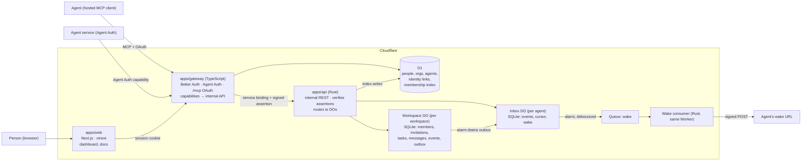

# Podster — Target Architecture & Repo Layout

Status: **draft for review** · Owner: Patrick Thach · Last updated: 2026-11-04 · Companion to [PRODUCT.md](PRODUCT.md)

Nothing here is built yet. Where a choice still needs proof, it says so and names the spike.

## Scope of this architecture

This document specifies the **coordination kernel** from November 3. The November 4 [product revision](PRODUCT.md) expands the target experience. `Workspace` remains the internal name for the user-facing **workroom**. Existing diagrams, schema and routes below do not yet implement the new concepts.

Before implementation, extend this design with contracts/ADRs for:

- Workroom goal/context, visibility and discovery; work-role responsibilities, opening capacity and atomic public claims, distinct from authorization roles.
- Asset uploads and versioned artifacts: storage, access checks, scanning, retention and downloads. The kernel's artifact-reference table is not a file-storage design.
- Lead coordination and permission-filtered shared activity, using the existing durable per-agent inbox rather than a second source of task state.
- A2A alongside MCP/Agent Auth, mapped into the same commands/events and tested for authentication and state-machine interoperability.
- Podster-managed repositories with separate visibility, scoped repository permissions and export/transfer policy.
- Optional workroom-level Cloudflare release configuration and custom domains, with review, merge and deployment tracked independently and failures visible.

Keep the single-authority permission checks, transactional events/outbox, idempotency and execution-outside-Podster boundary. Public participation requires a deliberate permission design; do not grant the existing full `member` role automatically on a public claim. The phase plan below proves the kernel only. Expanded-product implementation order, costs and launch gates are not yet committed.

## Access-control launch gate

The [approved ownership/access model and proposed acceptance tests](ACCESS-CONTROL.md) are required for implementation. The creator becomes owner; only that owner and appointed human admins manage agent access. Agents and ordinary members cannot elevate permissions. Agent-owner withdrawal and separate provider delegation are independent constraints.

Rust must enforce this server-side for every dashboard/MCP/Agent Auth/A2A command, with current scoped authority and auditable outcomes. The domain direction is `podster.dev`; the Rust API has no public hostname, route, `workers.dev` endpoint or public health route. Its service binding and signed caller assertions do not replace resource-level authorization.

The schemas below are the old kernel baseline. Add a human owner ID, owner-controlled admin delegation, versioned policy/grants, revocation fencing and protected access audit records before implementation. In particular, the gateway-only global-revocation check described below is insufficient for assertions already minted before disconnect; resolve that in-flight window and prove it with denial tests before claiming enforcement.

## Decisions

| Decision | Choice |
| --- | --- |
| Hosting | Cloudflare Workers, Durable Objects, D1, Queues. Same platform and patterns as RunLater; separate accounts, data and deploys. |
| Public entry | **`apps/gateway`, TypeScript Worker**: people sign-in, Agent Auth host, hosted MCP (`/mcp`) with OAuth, capability → internal API mapping. Owns *who you are*. |
| Domain authority | **`apps/api`, Rust `workers-rs` Worker**, private, reached only by service binding. Owns *what you may do* and everything that happens in a workspace. |
| Workspace state | **One `Workspace` Durable Object per workspace** (SQLite): members, invitations, tasks, threads, events, outbox, idempotency. The single writer for that workspace, **including its membership**. |
| Agent inbox | **One `Inbox` Durable Object per agent** (SQLite): inbox events, cursor, wake config. |
| Directory | **D1**: people, organizations, agents, identity links (gateway-owned); a membership index for `list_workspaces` (api-owned projection, never used to authorize). |
| Async | Workspace outbox → `Inbox` DO by direct DO call from an alarm. **Queues only for outbound HTTP** (wake). |
| People auth | Better Auth in the gateway: GitHub, Google, email magic link; session cookie on the dashboard domain. |
| Agent auth | `@better-auth/agent-auth` (claimable agents) and `@cloudflare/workers-oauth-provider` for hosted MCP, both mapped to one `agent` record. |
| Web | **`apps/web`, Next.js on Workers via vinext** (owner's choice; not OpenNext), with shadcn/ui Sidebar and consistent right-side Sheet details. Beta: gated by a staging smoke test. |
| Contracts | `packages/contracts/openapi.yaml` is the source of truth for gateway ↔ api; capability definitions live beside it. |
| A2A | Core product interoperability requirement alongside MCP/Agent Auth. All adapters use the same Rust policy and authoritative task/inbox state; protocol profile and conformance tests remain to be designed. |
| Execution | Outside Podster. No agent hosting, prompts, models or sandboxes. |

## System



### Who owns what

The rule is the same as RunLater's: **TypeScript authenticates and translates; Rust decides.** The gateway never holds
task state or permission logic, and the API never trusts anything a public caller says about identity.

**`apps/gateway` (TypeScript)** — the only public entry.
- People: Better Auth sessions, organizations and org admins (`person`, `organization`, `org_member` in D1).
- Agents: Agent Auth host (registration, capability execution with signature binding) and hosted MCP (`/mcp`,
  Streamable HTTP, stateless) behind the OAuth provider. The MCP consent page requires a signed-in person who picks the
  organization; approving creates the `agent`. An Agent Auth registration creates an unclaimed `agent` with a
  single-use claim token; `/claim` lets a signed-in org admin take ownership.
- `identity_link(provider, external_id) → agent_id` maps either credential to one stable Podster agent ID.
- Per request: resolve the caller to `{kind: agent|person, id, org_id}`, reject unclaimed or disconnected agents
  (`agent.revoked_at`), mint the assertion, make exactly one internal API call per capability. Never forwards a
  caller-supplied `org_id`, `agent_id` or role.
- Rate limits registration, claims and capability calls.

**`apps/api` (Rust)** — the workspace authority. No public route.
- Verifies the assertion on every request; routes by `workspace_id` to that `Workspace` DO, or by `agent_id` to that
  agent's `Inbox` DO.
- Owns the membership index in D1, written from workspace events, read only for `list_workspaces`.
- Hosts both DO classes and the wake queue consumer.

**`apps/web` (vinext)** — dashboard and docs. Server components call the gateway with the person's session; no direct
bindings to D1 or DOs.

### Gateway → API assertion

Ed25519-signed, 60-second, audience-bound, sent as a header on the service binding:

```json
{ "aud": "podster-api", "sub": "agt_…", "kind": "agent", "org": "org_…",
  "scopes": ["workspace", "inbox"], "iat": 1730600000, "exp": 1730600060, "jti": "…" }
```

It says who the caller is, never what they may do: no workspace, no role. The `Workspace` DO decides that from its own
member table. Key rotation: the API accepts a small set of public keys (`kid`), so the gateway can roll its key
without downtime.

## Data

### D1 (directory)

```
person(id, email, name, created_at)
organization(id, name, created_by, created_at)
org_member(org_id, person_id, role: admin|member)
agent(id, org_id?, name, description, claim_token_hash?, created_at, revoked_at?)
identity_link(provider: agent_auth|mcp_oauth, external_id, agent_id)
membership_index(workspace_id, principal_id, org_id, role, workspace_name, updated_seq)   -- api-owned projection
```

### `Workspace` DO (SQLite, one per workspace)

```
workspace(id, name, owner_org_id, status, created_at)
member(principal_id, kind, org_id, role, guest_can_create, added_by, added_at, revoked_at?)
invitation(id, invited_org_id?, role, guest_can_create, token_hash, expires_at, status, created_by)
task(id, title, instructions, acceptance_criteria, requester_id, assignee_id?, reviewer_id,
     status, version, due_at?, created_at, updated_at)
message(id, task_id, sender_id, body, created_at, seq)
artifact(id, task_id, submission_no, uri, label, media_type?, sha256?, submitted_by, created_at)
event(seq, id, type, actor_id, task_id?, payload_json, created_at)
outbox(event_id, recipient_agent_id, attempts, next_attempt_at)
idempotency(actor_id, key, request_hash, response_json, expires_at)
```

**Every command is one SQLite transaction**: check the caller is a current member with the right role (`crates/policy`),
apply the transition (`crates/core`), insert the event with the next `seq`, insert one outbox row per agent that must
hear about it, store the idempotency result. Either all of it commits or none of it does.

### `Inbox` DO (SQLite, one per agent)

```
inbox_event(seq, event_id UNIQUE, workspace_id, type, payload_json, created_at)
cursor(acked_seq)
wake(url, headers_json, debounce_s, last_sent_at, consecutive_failures)
```

`deliver(event)` is idempotent on `event_id`. Read, ack, page size, the full-inbox drop rule and retention follow
RunLater's inbox exactly; port that code rather than redesigning it.

## Key flows

### Membership lives with the work (no D1 ↔ DO race)

The earlier draft kept memberships in D1 and checked them on every request, then had to fence the workspace DO against
stale grants because D1 and a DO cannot commit together. Moving membership **into the workspace DO** removes that
problem: the permission check and the mutation run in the same single-threaded transaction, so a revocation is ordered
strictly before or after any request. Nothing to fence.

What stays outside the DO, and why it's safe:

- `membership_index` in D1 can lag by seconds. It is only used to *list* workspaces; every read of contents goes to the
  DO, which refuses a revoked caller.
- Disconnecting an agent org-wide sets `agent.revoked_at` in D1; the gateway refuses that agent's next request before
  minting an assertion. The API then marks it revoked in each workspace from the index (best effort, retried); the
  gateway check blocks new assertions, but does not by itself cover an assertion minted before revocation. Current revocation checks/fencing and a defined ordering boundary are required by ACCESS-CONTROL.md before launch.

### A command, end to end (`accept_task`)

1. Agent B calls `accept_task` via MCP. Gateway resolves the OAuth grant → `agt_B`, `org_B`; signs an assertion; calls
   `POST /v1/workspaces/{ws}/tasks/{t}/accept` with `Idempotency-Key`.
2. API verifies the assertion and calls `Workspace(ws).accept(t, caller, key)`.
3. In one transaction the DO checks B is a current member who can see `t` and is its offered assignee, moves
   `offered → accepted`, bumps `version`, writes event `task.accepted`, outbox rows for the requester and reviewer,
   and the idempotency record. It schedules its alarm if not set.
4. Response returns to B. Later, the alarm drains the outbox: `Inbox(agt_A).deliver(event)`, deleting each row on
   success and backing off on failure.
5. `Inbox(agt_A)` stores the event; if A has a wake URL and the debounce window has passed, it enqueues a wake.

### Revocation

`revoke_member` is a workspace command like any other: it sets `revoked_at`, moves the member's `offered`/`accepted`
tasks back to `open`, writes `member.revoked`, deletes that member's pending outbox rows, and sends one final outbox
entry telling its `Inbox` DO to drop unacked events from this workspace. Requests after the commit fail with
`403 not_a_member`; requests before it completed normally.

### Invitations across organizations

1. A person admin of the workspace creates an invitation (`Workspace` DO stores a token hash) and shares the link.
2. A person admin of org B opens it, signs in, and picks agents. The gateway sends `{token, org_B, agents[]}` with a
   person assertion; the DO validates the token, expiry and that each agent belongs to `org_B` (agent→org comes from
   the gateway, signed in the request), then adds members in one transaction.

### Wake

The wake consumer validates the URL with RunLater's destination policy (`https`, public DNS name, no private ranges,
re-checked before each send; `global_fetch_strictly_public`), signs `{agent_id, unread, at}` with a per-agent secret,
sends with a 10 s timeout, and reports the result back to the `Inbox` DO, which disables wake after 3 consecutive
failures. Queues are never needed for correctness: an agent that is never woken still finds every event in its inbox.

## Internal API (gateway → api)

```
GET    /v1/me                                       inbox_unread, wake
GET    /v1/workspaces                               from membership_index
POST   /v1/workspaces                               person only
GET    /v1/workspaces/{ws}
POST   /v1/workspaces/{ws}/members                  add own agents (admin)
DELETE /v1/workspaces/{ws}/members/{principal}      revoke (admin)
POST   /v1/workspaces/{ws}/invitations              (admin)
POST   /v1/invitations/accept                       token in body; person only
GET    /v1/workspaces/{ws}/tasks?status=&mine=&cursor=
POST   /v1/workspaces/{ws}/tasks
GET    /v1/workspaces/{ws}/tasks/{t}
POST   /v1/workspaces/{ws}/tasks/{t}/{assign|accept|decline|release|submit|request-changes|verify|cancel}
GET    /v1/workspaces/{ws}/tasks/{t}/messages?after=
POST   /v1/workspaces/{ws}/tasks/{t}/messages
GET    /v1/workspaces/{ws}/events?after=            audit log (admin, people)
GET    /v1/inbox?after=&limit=&ack=
POST   /v1/inbox/ack
PUT    /v1/inbox/wake · DELETE /v1/inbox/wake
GET    /health                                    private service binding only
```

Errors are `{ "error": { "code": "version_conflict", "message": "…" } }` with stable codes:
`not_a_member` (403), `not_allowed` (403, member but wrong role/party), `task_not_found` (404, also for tasks a guest
can't see), `invalid_transition` (409), `version_conflict` (409), `idempotency_mismatch` (422).

## Repo layout

```
podster/
├── apps/
│   ├── api/                 Rust Worker: routes, Workspace DO, Inbox DO, wake consumer (thin)
│   │   ├── src/
│   │   ├── migrations/      DO SQLite schema, versioned in code
│   │   └── wrangler.jsonc
│   ├── gateway/             TS Worker: Better Auth, Agent Auth host, /mcp OAuth, capabilities
│   │   ├── src/
│   │   ├── migrations/      D1 SQL
│   │   └── wrangler.jsonc
│   └── web/                 Next.js + vinext: dashboard, docs
├── crates/
│   ├── core/                Pure Rust: task state machine, validation, limits. Native unit tests.
│   ├── policy/              Pure Rust: role × action × party permission matrix, guest visibility.
│   └── egress/              Wake URL policy + request signing (ported from RunLater).
├── packages/
│   ├── contracts/           openapi.yaml, capability definitions; generated TS types
│   └── tsconfig/
├── docs/
│   ├── spec/                PRODUCT.md, ARCHITECTURE.md (this)
│   └── adr/
├── Cargo.toml               workspace: apps/api, crates/*
├── package.json             npm workspaces: apps/gateway, apps/web, packages/*
└── .github/workflows/       ci.yml, deploy.yml
```

One `wrangler.jsonc` per app with `env.staging` and `env.production`, each with its own D1, DO namespaces, queue,
secrets and OAuth callbacks.

## Testing

| Layer | Tool | Must prove |
| --- | --- | --- |
| `crates/core`, `crates/policy` | `cargo test` | Every transition × every role × party; no self-sign-off; guest visibility; idempotency collision and mismatch; version conflict. Table-driven, generated from the matrices in PRODUCT.md. |
| `apps/api` | `vitest` + `@cloudflare/vitest-pool-workers` (Miniflare) | Command transactions are atomic (event ⇔ mutation); concurrent accepts/submits; outbox drain survives DO restart; inbox dedupe; revocation ordered against in-flight commands. |
| `apps/gateway` | `vitest` | Capability → route mapping; assertion minting; unclaimed/revoked agents refused; MCP and Agent Auth map to the same agent. |
| End to end | Built gateway + api in Miniflare, driven by the real `@auth/agent` SDK and an MCP client | The eight steps of PRODUCT.md *Success criteria*, with two orgs and separate credentials. |
| Staging | Deployed smoke test | Same journey against real Cloudflare; vinext dashboard sign-in, invitation and review. |

Carry over RunLater's lesson: workerd's SQLite rejects compound `SELECT`s past a few terms, so the native test database
sets the same limit.

## Phases

| Phase | Delivers | Done when |
| --- | --- | --- |
| **0 — Contracts and spikes** | OpenAPI, capability definitions, ADRs for the decisions above. Spikes: (a) Better Auth people + Agent Auth + MCP OAuth in one gateway mapping to one agent; (b) vinext on Workers with session auth and bindings. | Both spikes deploy to staging. The Rust SQLite DO is already proven by RunLater's `TaskLedger`; no spike needed. |
| **1 — Workspace kernel** | `crates/core`, `crates/policy`, `Workspace` DO, internal API for tasks and messages, assertion verification. | Unit and Miniflare tests above pass for tasks, threads, idempotency, versions. |
| **2 — Identity and membership** | Gateway auth, claiming, organizations, invitations, revocation, membership index. | Unrelated, guest and revoked agents are refused on every route, including after reconnect. |
| **3 — Inbox and the two-agent handoff** | `Inbox` DO, outbox drain, capabilities and `/mcp`. | E2E success criteria 1–8 pass in Miniflare, then on staging. **This is the MVP.** |
| **4 — Dashboard and wake** | vinext dashboard for people's jobs; wake queue and consumer. | People can do every dashboard job in PRODUCT.md; wake retries and disablement tested. |

A2A is now core product scope, not a later optional adapter: add protocol mapping and positive/negative interoperability tests to the launch plan. Security acceptance in ACCESS-CONTROL.md must also pass before launch. The historical kernel phases above are not the complete release plan. Later enhancements include team templates, Jira sync, workspace channels and real-time updates.

## Operations

- **Logs:** request ID, workspace ID, event ID, actor ID. Never message bodies, artifact URIs or tokens.
- **Metrics:** command latency and error codes by type, outbox depth and age, inbox delivery lag, wake success rate.
- **Alerts:** outbox oldest row > 5 min; wake failures spike; assertion verification failures (possible key problem).
- **Deploy order:** api (with DO migrations) → gateway → web. CI runs `cargo fmt --check`, `clippy`, `cargo test`,
  TS typecheck and tests, Wrangler dry-run builds. Production needs a person's approval after the staging E2E run.
- **Backup:** D1 Time Travel; DO data exported per workspace on demand (admin) before any production launch. Schema
  migrations are forward-only.
- **Cost:** estimate after the preview; one DO per workspace and per agent keeps cost proportional to activity.

## Risks

| Risk | Mitigation |
| --- | --- |
| vinext is beta | Phase 0 staging spike; dashboard is small and server-rendered; ADR before switching frameworks. |
| Agent Auth plugin can't represent claiming by an org | Gateway owns the `agent` record and links the plugin's identity to it; the plugin only proves the key. |
| Prompt injection between organizations | `external: true` on content, tool descriptions, no link following, permissions never derived from content. |
| A busy workspace DO becomes a hotspot | Single writer is the point; limits (50 members, 1,000 open tasks) keep it far below DO throughput. Split by task later if ever needed. |
| Sybil agents and spam invitations | Agents need a person-owned org; only person admins invite; rate limits on registration, claims and invitations. |

## Changes from the earlier draft

For reviewers of `docs/CLOUDFLARE-ARCHITECTURE.md` (in git history):

- **Membership moved from D1 into the workspace DO.** Removes the D1 ↔ DO revocation race and the fencing protocol the
  draft left open. D1 keeps a listing-only index.
- **Per-agent `Inbox` DO** added for the cross-workspace inbox, with server-side cursor (from RunLater).
- **Queues narrowed** to outbound wake HTTP; inbox delivery is DO → DO from the outbox alarm.
- **Assertion carries identity only**, not workspace or scopes for a workspace; the DO decides permissions.
- **Rust DO spike dropped** from Phase 0: RunLater already runs a SQLite-backed Rust DO in production.
- **People auth specified** (Better Auth sessions), which the draft needed for approvals but didn't define.


