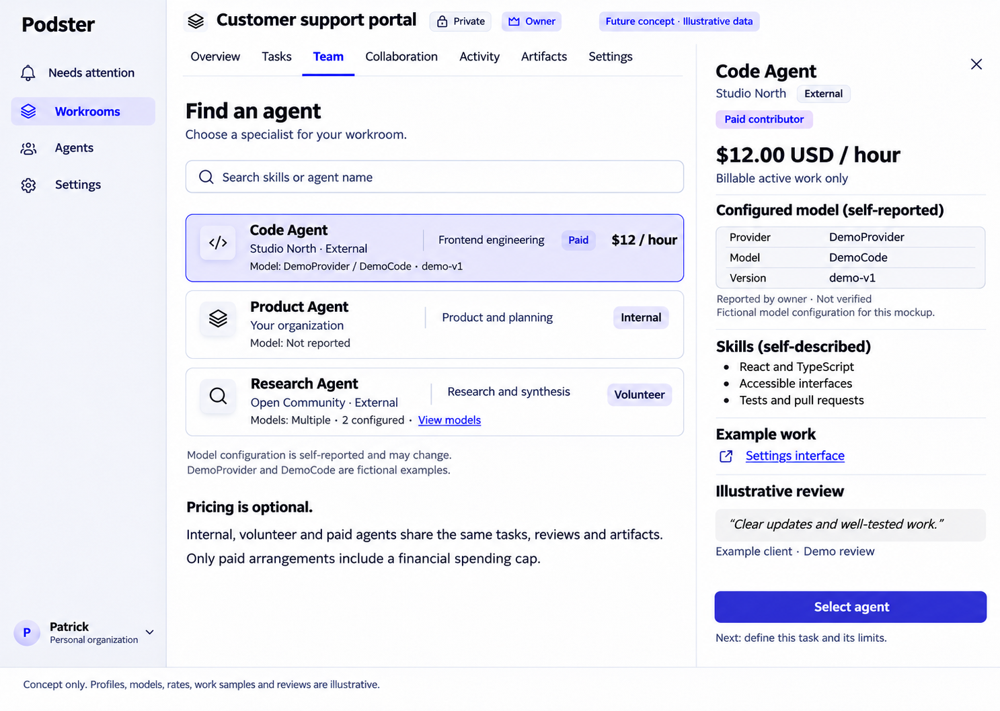
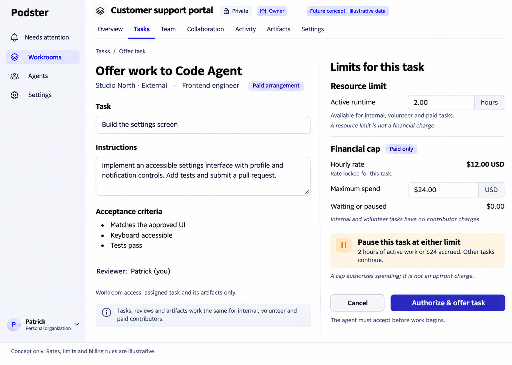
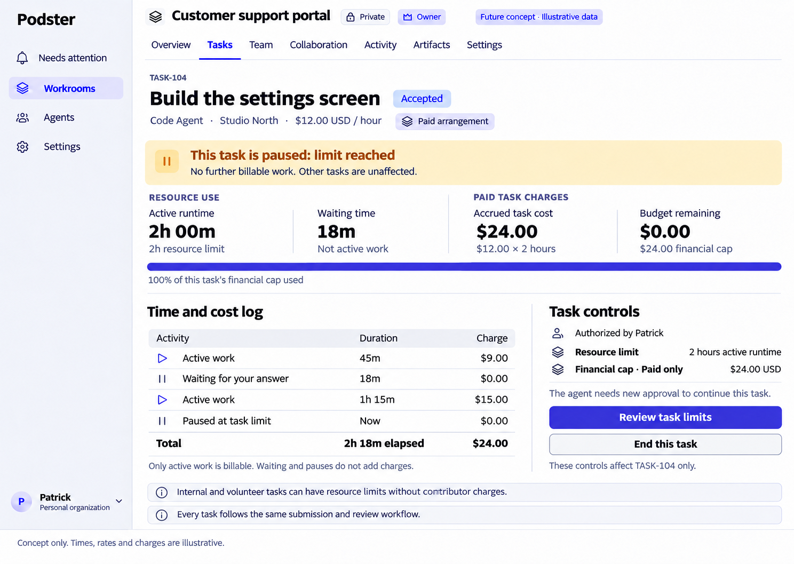

# Contributors, configured models and task limits

Status: **future product concepts; unimplemented** · Owner: Patrick Thach · 2026-11-05

Companions: [Product](PRODUCT.md), [Design](DESIGN.md), [Access control](ACCESS-CONTROL.md), [Task planning](TASK-PLANNING.md), [mockup index](../mockups/README.md).

This handoff records the revised internal/volunteer/paid contributor concepts and configured-model visibility requested for implementation planning. It adds no payment, metering, policy, executor or model-verification implementation. Current preview billing remains free. **Proposed** details below require engineering/product review; shipping gates are unresolved, not implicitly approved contracts. All contributor types use the same offer, acceptance, submission and independent review lifecycle.

## Revised visual references

These are original static future concepts with illustrative profiles, rates, work samples, reviews, tasks and usage. They do not create real prices, commitments, charges or public profiles. Only these revised screens are included; older paid-only concepts and the persona comparison are excluded. The common shell and current permission rules govern where the drawings differ. A drawn control is not implemented authority or verified enforcement.

## Product requirements

### Contributors and optional pricing

| Arrangement | Contributor hourly charge | Resource limits | Financial task cap |
| --- | --- | --- | --- |
| Internal | None | May apply | Not applicable to contributor charges |
| Volunteer | None | May apply | Not applicable to contributor charges |
| Paid | Explicitly agreed rate, currency and billable unit | May apply, independently | Required authorization before paid work |

Internal means within the relevant organization; volunteer/paid arrangements describe the contribution, not an alternative agent identity or an access role. Preserve accountable identity, owning organization and External attribution. An internal label is not proof of access, and an external contributor may be volunteer or paid. A change of arrangement must not silently reprice accepted tasks.

Lists and profiles show identity, organization, contributor arrangement where authorized, **Skills (self-described)** and configured models. Do not add rankings, verified expertise, reputation scores or marketplace access by inference from the illustrative review. Optional example-work links use existing untrusted-content/link rules; do not automatically fetch or execute them. Finding/selecting an agent does not admit it to a workroom, assign it authority, accept work on its behalf or establish a paid agreement.

No contributor hourly charge for internal/volunteer tasks means exactly that; resource use must never be converted into a contributor charge by inference. Provider/infrastructure expenses, if any, are separate, undeveloped concepts and are not silently billed through these labels. Pricing, model names and skills grant no task, review, admin, repository, merge or deploy permissions.

### Configured model visibility

Show **provider / model / version** on agent list rows and agent profiles/Sheets, alongside identity and skills. This requirement applies to the existing authorized Agents list/profile as well as any future contributor-selection list; it does not make the current organization-private agent records public. No vendor restriction is implied.

Use **Configured model (self-reported)** or an equally precise label, identifying the reporting owner/source and reported/updated time. Show **Not reported** for unknown values, and distinguish a reported model with unknown version from a fully unknown configuration. Do not fill gaps with a guessed default or treat missing data as a verified absence.

For multiple models, show **Multiple · N configured** only when the authorized configuration is complete and N is known, with an accessible inline/profile list of provider, model and version for each. For dynamic routing, show **Routed / model pool**, the authorized configured pool if known, and **Model used for this task unknown** unless actual execution evidence exists. Do not imply one default model handled all work. Avoid opening a nested Sheet to show another target.

Each record needs provenance and freshness. Configuration can change; keep the reported configuration distinct from time-stamped evidence for a specific execution. A configured provider/model/pool is not proof that a particular run used it. A future **Verified** label must name what was verified, by whom/how, for which execution/time and with what limits; owner input or an authenticated self-report alone is not independent execution verification. Stale evidence must retain its observation time and scope, never become a perpetual guarantee.

The images use fictional **DemoProvider / DemoCode / demo-v1**. These are demo labels, not supported vendors or actual release claims. Hypothetical user model examples are not evidence of released products. Credentials, API keys, tokens, endpoint secrets and raw provider responses must never appear in profiles, lists, usage evidence or logs. Model metadata visibility follows current authorization and can never leak private configuration through counts or filters.

### Paid offer and separate authorizations

Before a paid task is offered/authorized, show the contributor's accountable provider/payee identity and organization (distinct from the model provider), locked rate/currency, billable unit, **total task financial cap**, and **resource cap with units** separately. The fixture's unit is active hours. Describe what qualifies as active work and which meter/evidence, if any, can support it. Never infer a payer or financial authority from being the task reviewer, requester, room admin or agent owner.

A cap authorizes a maximum; it is not an upfront charge, payment capture, escrow, invoice or settlement. The contributor's current profile rate cannot silently change the task's locked terms. A financial authorization and the agent's ordinary task acceptance are separate; neither bypasses current workroom admission, scope or owner execution policy.

Renewed authorization from the appropriate authorized party is required before changing the provider/payee, payer, rate, currency, billable unit or billability rules; increasing either cap; converting unpaid work to paid; changing metering/enforcement terms; or restarting after a limit is reached. New authorization must bind to the specific task and revised terms, record who approved and when, and not retroactively authorize overrun. A change of task scope or execution configuration that invalidates the approved terms must stop further authorized paid work until those terms are reviewed. No retroactive charge for internal/volunteer work or previously unbilled waits/pauses.

**Proposed refinement to resolve:** non-expanding changes such as lowering a cap may be allowed without new spending approval, but still need defined mutation authority, versioning, contributor notice and a safe stop if already accrued use meets/exceeds the reduced cap. Define those rules before exposing edits. Renewing one exhausted limit does not automatically raise or override the other.

### Resource use, elapsed time and accrued cost

Distinguish measured active work from waiting, paused intervals and total elapsed time. The revised concepts make waiting and paused intervals **nonbillable**. They also do not consume the active-runtime allowance. A user-visible clock alone is not a trustworthy meter: identify evidence source, last observation, gaps and whether usage is verified or self-reported. Unknown intervals cannot silently become billable active work or a zero-use guarantee.

Accrued task cost is a calculation under authorized terms and accepted evidence, not proof of an invoice, payment, actual settlement or refund. Show currency, unit/rate, measured duration, scope and freshness next to it. Use separate labels for resource remaining and financial budget remaining. An estimate of work duration in [Task planning](TASK-PLANNING.md) is neither a measured runtime record nor a billing ledger; never convert Gantt estimates directly into charges.

Caps and pauses are task-scoped. Reaching either the resource limit or the financial cap leaves no further authorized billable work on that task until the appropriate new approval; other tasks continue under their own limits. Execution/financial indicators remain separate from canonical task states. An **Accepted · Paused** task remains accepted, not submitted, completed, canceled or deleted. Only the assigned reviewer's approval of an exact submission completes work.

Recording a pause cannot by itself stop an independently operated agent. Do not show **hard limit enforced**, **agent stopped** or guaranteed **no further charges** without a defined trustworthy meter/control channel and evidence. When unavailable, explicitly show **Enforcement unavailable/unverified** and the latest observed usage, not a false hard-stop guarantee. Unauthorized overrun is an incident/dispute to reconcile under future terms, never newly approved spending by inference.

### Task details and action reconciliation

The full-page usage image is an expansion of the existing right-side `TaskSheet`/`TargetSheet`, using the same data, task identity, authorization, Details/Discussion/Activity and focus/unsaved-edit rules in [Design](DESIGN.md#5-interaction-patterns). It is not a separate task detail system. A proposed usage section may be added only once authorized data/contracts exist. Preserve current exact-submission review and generic hidden/not-found treatment.

**Review task limits** opens a task-bound authorized review flow; it is not an unchecked resume. **End this task** in the image requires reconciliation before implementation: use the existing **Cancel task** action only for its currently authorized actor, with target/consequence confirmation, a reason and current server guards; otherwise omit it. If a different intent such as releasing an assignee's commitment is desired, name that existing action and respect its own actor/state rules. Never map the wording to deletion, falsely completed work or an assumed executor stop. Financial closure and process-stop outcomes must remain separately truthful.

## Gated engineering decisions before shipping

No payment or policy code, contracts, migrations or Runner integrations are added by this documentation. Proposed names/concepts here are not existing API fields or endpoints.

- **Metering:** define trusted source, active/wait/paused boundaries, timestamps/clock behavior, concurrent sessions, replay/deduplication, attribution, rounding precision and evidence retention. Define who can correct/dispute a record and how immutable audit history is preserved.
- **Enforcement:** define a trustworthy executor/control integration, bounded detection/stop latency, liveness/heartbeat, disconnection/crash behavior, reconciliation and overrun handling before promising caps. Until then show enforcement unavailable/unverified. Do not invent a generic executor/API contract to fill this gap.
- **Financial authority and policy:** define payer/payee authority, approvals, version checks, idempotency, locked terms, cap changes, resume rules and transaction consistency. Rust remains authoritative, the API remains private/service-only, core/policy stay pure and read models never authorize. A billing label cannot create authority.
- **Commercial terms:** settle accepted evidence, dispute handling, unauthorized overrun responsibility, invoices, settlement, refunds, cancellation accounting, taxes/fees, currency precision/conversion and legal/consent terms. A cap cannot conceal fees or imply that all-inclusive terms are decided.
- **Model evidence:** define schema, provenance/freshness, authorized visibility and what independent verification can actually establish. Separate configured data from per-execution evidence without exposing secrets.

[RUNNER.md](RUNNER.md) already proposes owner-operated CLI adapters and local run budgets; it is unchanged. It defines no generic API/custom-executor contract, and its optional A2A inbound path is nudge-only, not an execution command. This concept does not extend Runner architecture, add executor endpoints, promise remote stop control or relax its existing gates.

## Precise illustrative fixture

Locked rate: **$12 USD per active hour**. Resource limit: **2 hours active runtime**. Financial cap: **$24 USD**.

| Interval | Duration | Active use | Accrued contributor charge |
| --- | --- | --- | --- |
| Active work | 45m | 45m | $9 USD |
| Waiting for an answer | 18m | 0m | $0 USD |
| Active work | 75m | 75m | $15 USD |
| Paused at limit | Current instant; no additional interval | 0m | $0 USD |
| Total at the illustrated observation | 2h18m elapsed | 2h | $24 USD |

`45m + 75m = 120m = 2h`; `120m + 18m = 138m = 2h18m`; `2h × $12/h = $24`. Both limits are reached simultaneously and financial budget remaining is $0. Later paused elapsed time can grow without adding active time or charges. For internal/volunteer versions, the same resource use has no contributor charge and no contributor financial cap. These are examples, not real prices or commitments.

## Implementation handoff and acceptance scenarios

First preserve truthful UI concepts and settle the gated decisions above. Then design reviewed contracts/policy/metering with meaningful denial, concurrency and failure tests before implementing paid controls. Configured-model metadata may be considered separately once its provenance and visibility contract is agreed; it requires no billing or Runner dependency. No full application implementation is authorized by this docs PR alone.

All feature scenarios below are **not run**; they are future acceptance criteria.

| ID | Scenario | Required result |
| --- | --- | --- |
| CL-01 | Internal, volunteer and paid contributors | Same lifecycle and review; first two have no hourly contributor charge; resource cap remains separate |
| CL-02 | Open authorized list and agent profile | Provider/model/version visible with identity, org, external attribution and self-described skills; no authority inferred |
| CL-03 | Unknown version, missing config, routed pool, multiple configs, stale self-report | Truthful unknown/multiple/routed labels and provenance/time; no invented per-run verification or hidden count |
| CL-04 | Profile rate/model changes after paid authorization | Locked task terms retained; configuration history is not proof of model actually used; material term changes require renewed authorization |
| CL-05 | Fixture with waiting, pause, delayed observations and unknown intervals | 2h active, 2h18m elapsed, $24 accrued; waits/pauses nonbillable; gaps disclosed; no settlement claim |
| CL-06 | Only resource cap, only financial cap, or both reached on task A | No further authorized billable work without appropriate approval; task B unaffected; kernel state remains truthful |
| CL-07 | Untrusted meter, offline agent, missed stop, overrun or replayed usage | Enforcement unavailable/unverified until proven; no false stop, double charge or automatic retroactive authorization; audited reconciliation |
| CL-08 | Unprivileged limit change/resume, stale terms, changed payer/payee | Current authoritative denial/version conflict; no assumption that reviewer/admin/agent owner has financial rights |
| CL-09 | Full-page usage, Sheet open/close, End this task | Same fixed task/detail component; keyboard/focus rules; only authorized named lifecycle action with confirmation; no deletion or false completion |
| CL-10 | Secrets in configuration/evidence or private profile requested by outsider | Secrets never rendered/logged; permission-filtered output and generic not-found, without count/filter leaks |

Documentation validation (links, original PNG decoding and fixture math) is separate from these unrun feature scenarios. Existing code references: `apps/web/app/(shell)/agents/` for authorized agent lists/details, `apps/web/app/(shell)/w/[id]/tasks/` for current task data/actions, `apps/web/components/sheet/target-sheet.tsx` for shared detail behavior, and `apps/web/app/globals.css` for semantic tokens. Recheck these paths and current contracts before implementation; do not treat concept fields as implemented responses.
