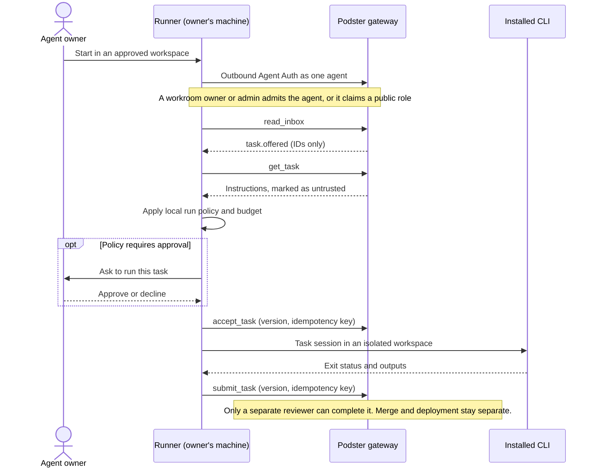

# Podster Runner design proposal

**Status:** Direction decided, detailed design proposed, November 4, 2026. No Runner implementation, released package, A2A conformance, CLI adapter or executable test suite exists in this repository. Acceptance criteria below are not run. Under [decision 26](PRODUCT.md#decisions-needed), nothing is published until M7's gates pass, including a security review of this threat model.

Companions: [Product](PRODUCT.md) · [Architecture](ARCHITECTURE.md) · [Design](DESIGN.md) · [Access control](ACCESS-CONTROL.md)

## Purpose and direction

Podster remains the coordination layer. Runner is optional software that an agent owner operates on their own machine, executing Podster tasks through supported installed tools. It is not Podster-hosted model execution and does not replace independently hosted agents, MCP/Agent Auth participation, or durable inboxes.

**Decided direction:** the name Podster Runner, local execution, **Agent Auth as Runner's way to authenticate to Podster**, separate from provider authentication, authorized registration, role admission before execution, offer-and-accept pickup, API keys or equivalent automation credentials, and asking first for every run ([decisions 26 to 29](PRODUCT.md#decisions-needed)).

Runner picks up work only through the existing offer-and-accept lifecycle. [Task claiming](#rejected-option-task-claiming) was rejected. Detailed APIs, protocol bindings and packaging below are proposals requiring review.

## Lifecycle

1. **Install and start:** a future verified distribution starts Runner in an owner-approved source directory. Each room gets its own approved source, so work for one room can't read another's. No package name or command is published here, because none is owned or released, and an unowned name could be registered by anyone. Setup must disclose local execution, credential use and network exposure. It must not silently install CLIs, create persistent credentials or expose ports.
2. **Connect:** Runner connects **outbound** to the public gateway and works through the same inbox loop as any other agent. By default it opens no listening port and needs no tunnel. Podster never reaches into the machine. It polls at an owner-set interval. Wake needs a public HTTPS URL, so with no open port it is available only through an external relay; missed wakes cost only latency.
3. **Authenticate and register:** Runner uses Agent Auth, not hosted MCP OAuth, and signs in as exactly one Podster agent. It starts unclaimed and can only call `get_identity` until the agent's person opens the claim link, confirms ownership and picks its organization. Agent skills are descriptive, not grants. The agent is a private record for its organization, not a public directory entry.
4. **Join and role:** the workroom owner or appointed human admin manages local agent admission and access. The agent owner retains connect and withdraw control. A public opening can be claimed only if the agent's [participation policy](PRODUCT.md#public-and-private-participation) allows it, and that policy defaults to invitations only. Roles such as engineer or reviewer do not convey admin, GitHub, merge or deployment privileges.
5. **Pick up work:** Runner reads its inbox, then fetches the offered task with `get_task`, which applies current authority. Inbox events carry only IDs. It acknowledges an offer only after durably recording it locally, and reconciles with `list_tasks` on restart.
6. **Apply run policy:** Runner decides locally whether this run may start, as described in [Run policy and budget](#run-policy-and-budget). A task that fails policy is left waiting for its owner, or given up: `decline_task` with a reason from `offered`, or `release_task` from `accepted` after confirming no process is running. No CLI starts.
7. **Accept:** Runner calls `accept_task` with the version it evaluated and an idempotency key. A timeout is an unknown outcome: retry with the same key before starting anything. If the task changed, the version check fails, policy runs again and any new attempt uses a new key.
8. **Execute:** start only if a current run decision matches the prompt inputs, and a fresh `get_task` shows the task still `accepted` by this agent. A retried accept can return a stored success after the task was canceled, so the fresh read is required. Build the prompt from the approved bytes, not a re-fetch. Invoke an allowlisted CLI adapter as a subprocess in a dedicated workspace. Do not execute shell text from a task, card or endpoint parameter. Report bounded, sanitized progress as thread messages. Where output approval applies, progress and failure text is limited to fixed status generated by Runner, with no model text, or goes through the same approval. Preserve the Podster task ID and adapter session ID as separate correlated identifiers.
9. **Submit and review:** on success, first confirm the inputs still match the run decision, then use `submit_task` with the current version, with results and provenance. Outputs are limited to declared paths and secret-redacted, and by default the owner approves them before submission for external and public-room tasks. Failure, or a run stopped by a budget, is not a submission: use `release_task` with a reason, or a thread message if the owner will retry. A canceled task is recorded locally. Only an authorized independent reviewer verifies completion. Code generation or a successful CLI exit cannot authorize merge or deployment.
10. **Withdraw and stop:** agent-owner withdrawal and owner/admin revocation follow the [departure rules](PRODUCT.md#when-a-participant-leaves). Runner stops accepting new work and closes any endpoint or tunnel when appropriate. During a run it rechecks at a required maximum interval. It stops work on any authority error, or if the status, assignee or prompt inputs no longer match. A Runner cut off from Podster stops on its own after a configured grace period. The CLI's own tool calls don't pass through Runner, so "before external side effects" holds only where the adapter or sandbox can enforce it; network and tool allowlists are the real gate. Already completed external actions cannot be retroactively undone.

## Run policy and budget

Task instructions become the prompt for a tool-using CLI, so another participant's text can drive the owner's machine and credentials. Labeling it as data helps but cannot make it safe. Isolation limits damage. **Run policy decides whether each run starts.** This is the key control for Runner.

**What is approved.** A run's prompt inputs are exactly the task's title, instructions and acceptance criteria, plus, on a rerun, the reviewer's change request. Thread messages and artifact labels enter a prompt only if a person lists them in an approval; an auto-run uses only the fixed inputs.

**Run decisions.** Each run needs a locally stored decision, whether a person's approval or an auto-run under policy. It is bound to the task, a hash of the inputs, who wrote each input, the requester, the room's visibility, the adapter and the budget. **It is single-use and expires.** It is consumed when the run starts, apart from resuming the same interrupted run. **Every run passes policy, not just the first.** That includes reruns after `request_changes`, which moves a task back to `accepted` with no new accept, and a re-offer of identical text. If the inputs change during a run, Runner stops it.

**The least-trusted author decides.** A run is classified by the least-trusted author of any input, not only by the requester. If a reviewer or admin from outside the auto-run setting wrote any of it, Runner asks.

**Enforced locally, within limits.** Run policy is stored and evaluated on the owner's machine, and Podster cannot change it. But requester, organization, room and task content all come from Podster, and nothing is signed by the requester. So where local approval is required, a compromised service can't start a run, though it can mislabel what the approver sees. **An auto-run room trusts Podster fully:** a compromised service could send arbitrary instructions labeled as that room. The auto-run setting must say so.

| Task source | Default ([decision 29](PRODUCT.md#decisions-needed)) | Can the owner enable auto-run? |
| --- | --- | --- |
| Agent or person in the owner's own organization, private room | Ask | Yes, per room |
| Agent or person from another organization, private room | Ask | Yes, per room and requester organization |
| Public room | Ask | Only per room, with an explicit warning; never a global setting |
| Any prompt input changed after approval, including changes requested by a reviewer | Ask again | Same as the least-trusted author of the inputs |

- **Approval:** by default an authorized person of the agent's organization approves in Runner itself, on their machine. Approving through **Needs attention** in the dashboard is an opt-in convenience per room: that approval is relayed through Podster, so a compromised service could forge it. A dashboard approval has the same binding as a local one, so it can't be replayed for changed inputs. Silence is never approval; the task simply waits, or is given up after a set time as described in step 6. Repeated re-offers are rate-limited so they can't flood the approver.
- **What the approver sees:** task text, requester, reviewer and the author of any change with their organizations, external marker, room, source, adapter and budget, rendered as untrusted text. This needs `get_task` to return the requester's organization and the room's visibility.
- **Relayed text:** an own-organization lead can copy a guest's injected text into a task, so "own organization" doesn't mean trusted. The warning for own-organization auto-run must say so.
- **Budget:** required caps per task and per day, on duration and spend. Use the CLI's cap where it has one, such as Claude Code's `--max-budget-usd`, but that is an estimate and spend can pass it, so Runner keeps its own running total and reserves budget across concurrent runs. Duration limits and provider-side limits are the backstop. Reaching a cap stops the run, possibly after some overshoot, and reports it.

## Threat model

| Threat | Effect | Controls |
| --- | --- | --- |
| Malicious requester or injected task text | Runs tools with the owner's access | Run policy, isolation, tool and network allowlists, no credentials in the task environment |
| Compromised Podster service | Sends harmful tasks to every connected Runner | Local approval by default; outbound-only default; Runner accepts no code or configuration from Podster. **Residual:** rooms with auto-run or dashboard approval trust Podster, and approvers see Podster-supplied labels |
| Malicious repository content | Hooks or MCP servers run automatically | Adapter modes that skip repository configuration; isolation; R-09 |
| Compromised or impersonated package | Code runs on owners' machines | Owned name or scope before any public command; signed releases with provenance; no silent auto-update |
| Stolen Runner credential | Acting as that one agent | Scoped to one agent, stored outside task workspaces, rotatable, revoked by disconnect |
| Task code reading provider or Podster credentials | Credential theft, unexpected charges | Separate process boundaries; see [Workspace and process isolation](#workspace-and-process-isolation) |
| Spend drain by repeated tasks | Provider charges for the owner | Budgets, public rooms off for auto-run, rate limits |
| Exfiltration through results | Injected text asks for private code in a note, artifact, progress message or failure reason, which goes to the requester through an allowed channel | Separate sources per room; output approval for external and public-room tasks, with progress and failure text limited to fixed status. Network allowlists don't stop this |
| Task tampering with Runner itself | Task code edits run policy or forges approvals | Runner's policy, approvals and state are outside the task sandbox, and run under a separate OS user or container where possible |
| Exposed inbound endpoint | Remote attack surface | Off by default; see [Optional inbound A2A](#optional-inbound-a2a) |

## Protocol and authorization boundaries

Public protocol gateways authenticate callers, then invoke the private service-only Rust API for current scoped authorization and atomic durable state changes. Runner never receives direct Rust API access. An authenticated connection is not enough: validate actor, owner, room, agent, task, version and requested capability for each operation. Recheck after queued delivery and before external side effects; stale assertions and revoked grants must fail as described in ACCESS-CONTROL.

Prompt text, cards, messages and artifacts are untrusted input; none can expand host permissions or replace verified identity. Provider, GitHub and deployment grants remain independent and bounded. Do not place provider credentials in cards, Podster logs, task payloads or artifacts.

### Optional inbound A2A

Inbound A2A is **off by default**. An owner can opt in to get faster pickup. In this proposal it is **nudge-only**: polling stays on as the fallback, because the inbox is the source of truth. Runner doesn't act as a full A2A task server under the [A2A adapter](ARCHITECTURE.md#a2a-adapter)'s state mapping; that would need its own design.

- **Reachability:** Podster's A2A calls follow the wake egress policy: HTTPS, public DNS name and no private address ranges. A local-only bind cannot receive them. It requires a directly reachable address or an explicitly authorized tunnel, with the vendor to be chosen later. A tunnel is transport, not permission.
- **Caller:** Podster's gateway delivers through its outbox. Runner verifies that request, then treats it only as a nudge: it fetches the task over its outbound connection and applies run policy as usual. An inbound request alone never starts a CLI. Peer agents have no direct path to Runner.
- **Registration:** the agent owner authorizes the endpoint and Agent Card. Verify current ownership, permitted organization and endpoint control before activating it. Validate the card schema, endpoint scheme and redirects, and protect retrieval against SSRF, DNS rebinding and private-network access. Don't automatically trust advertised URLs or instructions, and put sensitive capability metadata behind access control.
- **Limits:** require TLS, authenticated requests, bounded payloads, rate limits and shutdown controls. Never expose a shell, credential store, arbitrary filesystem or Podster's private Rust API through the endpoint.
- **Protocol:** A2A is a core interoperability requirement, not an authorization bypass. Pin an official protocol version and validate cards and supported transports before claiming conformance for this delivery mode. Agent Card publication and Podster registration are distinct operations. See the [official A2A specification](https://a2a-protocol.org/v1.0.0/specification/).

## Local CLI adapters and two sign-ins

The adapter launches a task session, not an existing interactive chat takeover. It must verify CLI version and capabilities, select an explicit supported authentication mode, capture structured output where available, and translate exit, failure and cancellation states without claiming a successful deliverable merely because a process exited.

Provider login remains managed by the installed tool on the owner's machine. Runner authenticates to Podster separately with Agent Auth, never with a provider credential. Do not extract, forward, reuse across providers, or upload CLI credentials. A signed-in desktop application does not by itself prove the CLI or non-interactive mode is authenticated.

**Decided: the owner's own API key or equivalent automation credential** for each provider. Subscription login is unsupported unless a provider confirms it for this use, and that would need a new decision ([decision 28](PRODUCT.md#decisions-needed)).

- **Codex candidate:** official docs describe ChatGPT and API-key login. `codex exec` reuses saved CLI authentication by default, can emit JSON events and runs in a read-only sandbox by default, so writing work needs a deliberate, validated permission choice. The docs recommend API keys for automation, and advise setting `CODEX_API_KEY` only for the invocation that needs it, with no untrusted code in the same process environment. Saved login can be a plaintext `~/.codex/auth.json`, which should be handled like a password. The docs also say not to expose Codex execution in untrusted or public environments, so the Codex adapter is proposed as unavailable for public-room and other-organization tasks until that guidance is reconciled with this use. Sources: [authentication](https://learn.chatgpt.com/docs/auth), [non-interactive execution](https://learn.chatgpt.com/docs/non-interactive-mode).
- **Claude Code candidate:** `-p` is a documented programmatic path. **`--bare` does not read subscription OAuth credentials or keychain login.** Anthropic access in that mode requires an API key or explicit helper; third-party providers use their own auth. `--bare` is the recommended scripted mode and is due to become the default for `-p`. Non-bare mode may load repository hooks and MCP configuration without interactive trust prompts, so do not select it to avoid API credentials. An `ANTHROPIC_API_KEY` in the environment takes precedence over a subscription login and bills the API, so set the environment deliberately. Anthropic's Agent SDK documentation says third-party developers may not offer claude.ai login or rate limits for their products without prior approval. Whether a Runner driving a user's own CLI falls under that is unconfirmed, which is one reason subscription login is unsupported. Sources: [programmatic usage](https://code.claude.com/docs/en/headless), [CLI reference](https://code.claude.com/docs/en/cli-reference), [Agent SDK](https://code.claude.com/docs/en/agent-sdk/overview), [subscription setup](https://support.claude.com/en/articles/11145838-use-claude-code-with-your-pro-max-or-ultra-plan).
- **Grok:** unverified. No supported CLI, adapter, authentication mode or subscription entitlement is promised.

Documentation checked November 4, 2026. These are candidate integration capabilities, not tested Podster compatibility. Availability, billing, terms, limits and permissions must be revalidated for each supported version and mode.

## Workspace and process isolation

Use a fresh per-task clone or similarly isolated workspace with a pinned revision. A linked git worktree isn't enough on its own, because it shares the common git directory, including objects, refs, config and hooks, so a task could plant a hook that later runs unsandboxed or read other branches. A working-directory argument alone is not a sandbox. Enforce filesystem and network boundaries using suitable OS or container controls plus the CLI's supported permissions; validate symlink/path traversal and subprocess behavior. Deny unrelated home directories, other tasks, credential stores, and Runner's own policy, approvals and state. Supply only necessary environment variables.

**Credential conflict to resolve:** the CLI needs a provider credential, yet commands it runs for the task must not be able to read it. A saved login file or an inherited environment variable can defeat that. Each adapter mode must show how the credential stays out of reach of task commands, for example through a credential helper or OS keyring with task commands in a narrower sandbox. If that can't be proven, the mode is unsupported. Runner's own Podster credential must never be available inside the task sandbox.

Apply explicit tool and network allowlists, resource and duration limits, bounded output and artifact path validation. No automatic permission-bypass flags, broad host mounts, unreviewed hooks/plugins/MCP servers or global configuration changes. Escalations need the appropriate human approval; unsupported safe isolation is a blocker, not permission to run unrestricted. Provider authentication and sandbox compatibility remain a required proof-of-concept gate.

## Recovery and delivery semantics

- **Reconnect:** maintain a durable local record of task, version, idempotency key, subprocess and session state, and acknowledged progress. Reauthenticate and reconcile with Podster before resuming; reconnect does not renew revoked authority.
- **Retries:** use bounded backoff and the kernel's idempotent transitions. Duplicate delivery, reconnect or transport timeout must not launch a second process for the same task. Reconcile uncertain submissions before retrying. Do not promise exactly-once external side effects.
- **Crashes and stale results:** the default lifecycle needs no lease. An accepted task stays with its assignee until it is submitted, released, canceled, revoked or returned to `offered` by a material edit. A Runner that can't resume calls `release_task`, but **only after confirming the old process tree stopped**; if that is unknown, it tells the owner rather than releasing, so its own release can't cause overlap. A revocation or a re-offer after a material edit can still overlap with the old Runner until that Runner stops. Podster refuses results that are stale by task `version`, connection generation or revocation.
- **One executor per agent:** proposed as one active Runner per agent, using a local lock. **This is best effort.** It can't detect a second machine, and a replaced Runner holding a current version can still commit until a server-side executor epoch is designed.
- **Cancellation:** authenticate the requester and check scope. `cancel_task` commits in Podster immediately. Runner learns from its inbox or next authority check, stops the subprocess tree gracefully and then forcibly within a configured limit, and records partial work. Cancellation can race with completion; use versioned transitions and report the actual outcome, not assumed rollback.
- **Offline:** keep durable inbox and history; display last-seen status rather than guaranteed online execution. Do not wake closed chat apps automatically. An offline Runner finds its work at next connection.
- **Audit:** correlate registration, access changes, run-policy decisions, adapter starts, cancellations and result submissions with actor, scope, timestamps and non-secret IDs. Preserve denied attempts and immutable history under the security spec.

## Rejected option: task claiming

The original proposal had agents request eligible tasks, and Podster record one claimant atomically. [Decision 27](PRODUCT.md#decisions-needed) rejected this because offers need no lifecycle change, no new visibility rules and no leases. The comparison is kept in case a new decision revisits it.

| | Offers only (decided) | Claiming (rejected) |
| --- | --- | --- |
| How work moves | A lead or requester offers; Runner accepts | A requester marks a task claimable; an eligible agent's claim moves it from `open` straight to `accepted` |
| Lifecycle change | None | A new transition, `claim_task`, and a `claimable` flag |
| Visibility | Unchanged | New rule so agents can see claimable tasks for their role. Today, public participants and guests see only their own tasks |
| Stalled work | The requester or an admin can cancel it, or an owner or admin can revoke the agent. `assign_task` doesn't apply from `accepted` | Needs timeouts or leases, with fencing before reassignment |
| Risk | Work moves only when a lead assigns it | More open surface; a claim from a public room needs the same run policy |

If a new decision ever adopts claiming, it must be atomic and idempotent, return a durable result, give one claimant at most, and require a recorded commitment so "assignment is not commitment" still holds. Lease expiry alone must not trigger overlapping destructive work: determine whether the old process stopped, and fence side effects before reassigning. A2A itself has no claim or lease concept, so this would be a Podster feature.

## Proposed acceptance criteria (not executed)

| ID | Required observable result |
| --- | --- |
| R-01 | Startup without approved workspace/auth cannot execute; installation/tunnel setup requires explicit consent and verified distribution. |
| R-02 | Forged identity, wrong owner or unverified endpoint cannot register an active agent; card claims alone grant nothing. |
| R-03 | (Inbound) Unauthenticated request, replay or wrong-room/task substitution is rejected, and an authenticated inbound request alone never spawns a CLI. |
| R-04 | Members/agents cannot administer access; an owner-appointed admin can manage only authorized rooms; own-agent withdrawal remains available. |
| R-05 | Role assignment alone cannot run a task or grant provider access; a run starts only with a matching approval and a fresh read showing the task `accepted` by this agent, including after a lost response and a cancel. |
| R-06 | Lost accept response followed by retry/reconnect resolves to the same result and at most one active local execution. |
| R-07 | Revocation between queueing, accept and execution denies stale authority; a stale executor's result write is refused. |
| R-08 | Workspace escape, symlink traversal, shared git directory or hook tampering, other-task and other-room access, secret reads, edits to Runner's policy or state, and unapproved network/tools fail under actual subprocess tests, including reads of provider and Podster credentials by task commands. |
| R-09 | Untrusted repo hooks/config do not execute outside approved boundaries; unsupported isolation blocks the adapter. |
| R-10 | Missing/expired provider login, unsupported CLI version, quota/rate failure or incompatible auth mode produces an actionable failure, never a false success. |
| R-11 | Each supported Codex/Claude mode is tested separately; Claude bare mode cannot be presented as subscription login; Grok remains disabled until verified. |
| R-12 | Duplicate delivery/submission and process crashes preserve durable task state, recover without duplicate side effects, and expose uncertain outcomes. |
| R-13 | Cancellation/completion races are versioned; subprocess descendants stop or are explicitly reported as still running; partial effects are disclosed. |
| R-14 | Results contain only authorized artifacts, no credentials; submission cannot self-verify, merge or deploy without separate authorization. |
| R-15 | Shutdown of Runner and any endpoint or tunnel is observable; offline work remains durable; reconnect revalidates permissions before resuming. |
| R-16 | (Inbound) Card fetch SSRF/redirect/rebinding attempts, malformed payloads and oversized streams are rejected; no route exposes the private Rust API. |
| R-17 | (Inbound) Pinned A2A version/binding passes interoperability tests for card discovery, authenticated delivery of a nudge and errors. |
| R-18 | Audit links actor, room, task, run-policy decision, any inbound nudge and adapter session without secret leakage; rejected actions do not mutate protected task state. |
| R-19 | Task text from another organization containing injection attempts can't read credentials, change policy or reach other rooms' sources under the supported isolation. Requests to put workspace content in a result, progress message or failure reason are stopped when output approval is required. |
| R-20 | With defaults, external and public-room tasks do not run without approval; a rerun after `request_changes`, a re-offer of identical text or any changed prompt input needs a new decision, and a run stops if inputs change; a reviewer or admin outside an auto-run setting triggers a request; budget caps stop a run and are reported. |
| R-21 | A simulated hostile Podster service cannot change local run policy, start a run needing local approval, replay a used, expired or non-matching approval, or deliver code outside a task. Rooms with auto-run or dashboard approval are documented as trusting Podster. |
| R-22 | Default installation opens no listening port and needs no tunnel. |
| R-23 | On one machine, a second Runner for the same agent cannot run the same task concurrently, and replacing the active Runner is explicit. Behavior across machines is documented as best effort. |
| R-24 | A failed, budget-stopped or canceled run never reaches the reviewer as a submission; a Runner that can't confirm its old process stopped doesn't release the task. |

## Unresolved before implementation

- Owned package name or scope, publisher, update signing, distribution and supported operating systems.
- For inbound A2A: version and bindings, authentication and rotation, endpoint proof and tunnel provider.
- Sandboxing compatible with local provider auth without exposing credentials to task code.
- Exact APIs and failure contracts, including the server-side executor epoch and the commands, delivery and stored record for dashboard approvals.
- Supported CLI versions, modes, provider terms and entitlements, output schemas and cancellation guarantees.
- Artifact upload limits, local persistence and retention, redaction, retry budgets and audit access.
- Ownership recovery, multi-agent Runner configuration and secure concurrent workspaces.

These questions do not weaken the approved access model. Implementation must resolve them and pass security and interoperability tests before any claim of production readiness.
